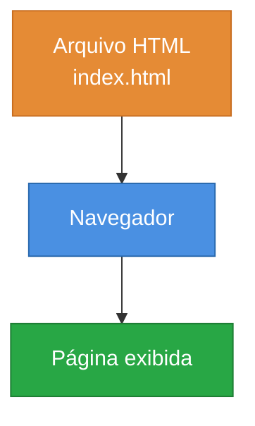
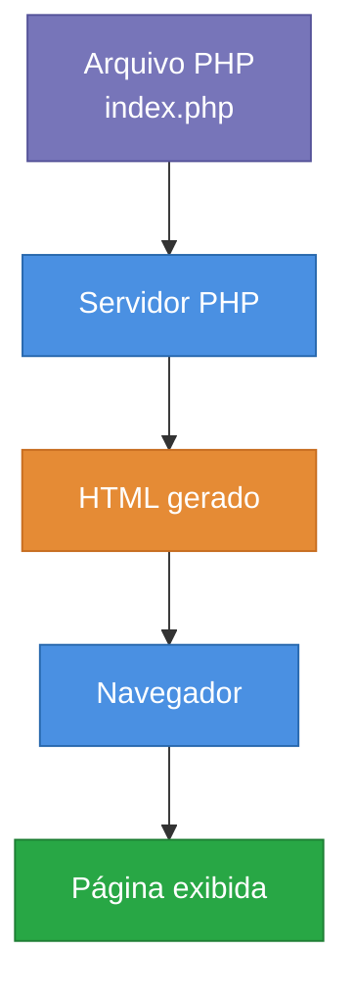

# Diferença entre index.html e index.php

Os dois arquivos são parecidos, mas existe uma diferença fundamental na forma como são executados.

1. index.html

- É um arquivo HTML estático.
- O navegador consegue interpretar diretamente.
- Não precisa de servidor PHP.
- Pode ser hospedado gratuitamente no GitHub Pages.

2. index.php

- É um arquivo que pode conter HTML, CSS e código PHP.
- Precisa de um servidor com suporte ao PHP.
- O código PHP é executado no servidor antes de chegar ao navegador.
- Não funciona diretamente no GitHub Pages.

## Visualizando a diferença

No HTML



No PHP



## Qual utilizar no seu projeto?

Se sua intenção é apenas apresentar a linguagem PHP, utilizando HTML e CSS, você tem duas possibilidades:

- index.html: se não precisa executar nenhum código PHP.
- index.php: se deseja demonstrar funcionalidades da linguagem PHP, como variáveis, funções, datas e conexão com banco de dados.

Inclusive, no exemplo que criamos, utilizamos:

```php
<?php echo date("Y"); ?>
```
Isso gera automaticamente o ano atual no rodapé. É uma funcionalidade que exige PHP.
