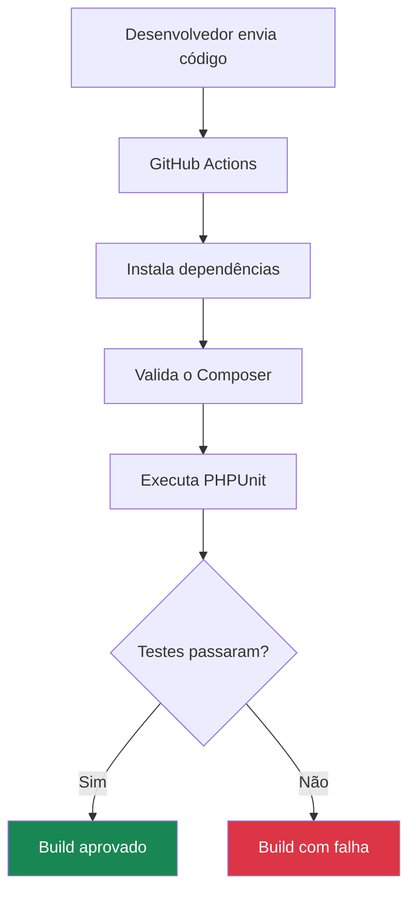

# Testes Unitários

Você consegue aplicar testes unitários em PHP utilizando ferramentas como o PHPUnit, que é um dos frameworks mais conhecidos para testes automatizados em PHP.

Inclusive, podemos integrar os testes ao seu GitHub Actions para que sejam executados automaticamente sempre que você enviar alterações para o repositório.

## 1. Instale o PHPUnit pelo Composer

Atualize seu `composer.json`:

```json

{
    "name": "projeto/apresentacao-php",
    "description": "Página de apresentação sobre PHP",
    "type": "project",
    "license": "MIT",
    "require": {
        "php": ">=8.1"
    },
    "require-dev": {
        "phpunit/phpunit": "^11.0"
    },
    "autoload": {
        "psr-4": {
            "App\\": "src/"
        }
    },
    "autoload-dev": {
        "psr-4": {
            "Tests\\": "tests/"
        }
    },
    "scripts": {
        "test": "phpunit"
    },
    "config": {
        "optimize-autoloader": true,
        "sort-packages": true
    }
}
```

## 2. Organize as pastas do projeto

Uma estrutura recomendada:

text

```text
apresentacao-php/
│
├── .github/
│   └── workflows/
│       └── php.yml
│
├── src/
│   └── Calculadora.php
│
├── tests/
│   └── CalculadoraTest.php
│
├── index.php
├── composer.json
└── phpunit.xml
```

## 3. Crie uma classe PHP para testar

Arquivo `src/Calculadora.php`:

```php

<?php

namespace App;

class Calculadora
{
    public function somar(int $a, int $b): int
    {
        return $a + $b;
    }

    public function subtrair(int $a, int $b): int
    {
        return $a - $b;
    }

    public function multiplicar(int $a, int $b): int
    {
        return $a * $b;
    }
}
```

## 4. Crie os testes unitários

Arquivo `tests/CalculadoraTest.php`:

```php

<?php

namespace Tests;

use App\Calculadora;
use PHPUnit\Framework\TestCase;

class CalculadoraTest extends TestCase
{
    public function testSomar(): void
    {
        $calculadora = new Calculadora();

        $resultado = $calculadora->somar(10, 5);

        $this->assertEquals(15, $resultado);
    }

    public function testSubtrair(): void
    {
        $calculadora = new Calculadora();

        $resultado = $calculadora->subtrair(10, 5);

        $this->assertEquals(5, $resultado);
    }

    public function testMultiplicar(): void
    {
        $calculadora = new Calculadora();

        $resultado = $calculadora->multiplicar(10, 5);

        $this->assertEquals(50, $resultado);
    }
}
```

## 5. Configure o PHPUnit

Crie o arquivo `phpunit.xml`:

```xml

<?xml version="1.0" encoding="UTF-8"?>
<phpunit bootstrap="vendor/autoload.php"
         colors="true">

    <testsuites>
        <testsuite name="Testes Unitários">
            <directory>tests</directory>
        </testsuite>
    </testsuites>

</phpunit>
```

## 6. Atualize seu GitHub Actions

No arquivo `.github/workflows/php.yml`, acrescente a execução dos testes:

```yaml

name: PHP Composer

on:
  push:
    branches: ["main"]
  pull_request:
    branches: ["main"]

permissions:
  contents: read

jobs:
  build:
    runs-on: ubuntu-latest

    steps:
      - uses: actions/checkout@v4

      - name: Setup PHP
        uses: shivammathur/setup-php@v2
        with:
          php-version: '8.2'
          tools: composer

      - name: Validate composer.json
        run: composer validate --strict

      - name: Install dependencies
        run: composer install --prefer-dist --no-progress

      - name: Check PHP syntax
        run: php -l index.php

      - name: Run PHPUnit tests
        run: composer test
```

## 7. Execute os testes

Na sua máquina, execute:

```bash
composer install
composer dump-autoload
composer test
```

Resultado esperado:

PHPUnit

PASSOU

```text
PHPUnit 11.x

...                         3 / 3 (100%)

OK (3 tests, 3 assertions)
```

## 8. Como funciona o processo?



## Outras ferramentas interessantes

| Ferramenta | Finalidade |
| --- | --- |
| PHPUnit | Testes unitários |
| Pest PHP | Testes com sintaxe simplificada |
| PHPStan | Análise estática de código |
| PHP\_CodeSniffer | Padronização do código |
| Infection | Testes de mutação |

Minha recomendação: comece com PHPUnit. Ele permitirá demonstrar no seu GitHub não apenas conhecimentos de PHP, mas também práticas de qualidade de software, testes automatizados e integração contínua (CI/CD).

Uma evolução interessante seria implementar testes para as funcionalidades reais da sua página, separando a lógica PHP do HTML.

